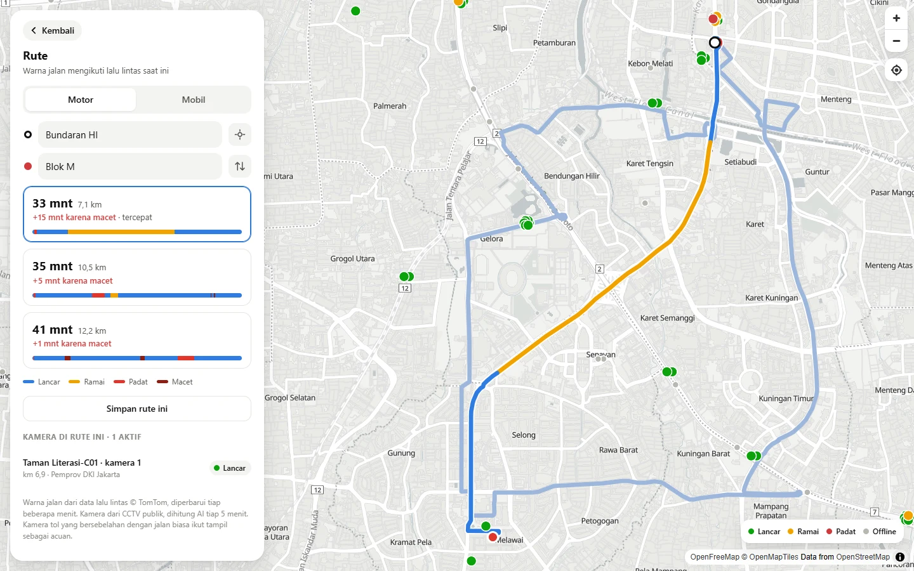

# traffic-cctv-tracker

Peta lalu lintas Jabodetabek dari CCTV publik.

https://traffic.valentinodeenata.com

## Fitur

- 475 kamera di peta (DKI, jalan tol, Bina Marga), sekitar 210 online
- Status Lancar / Ramai / Padat per kamera, diperbarui tiap 5 menit
- Deteksi kendaraan bergerak dan berhenti dari 2 frame berjarak 2 detik
- Status dibandingkan dengan kondisi normal kamera di jam yang sama
- Video live dari server pemilik kamera
- Tampilan hasil deteksi AI per kamera
- Grafik 24 jam per kamera
- Rute motor (tanpa tol) dan mobil, diwarnai sesuai lalu lintas saat ini
- Daftar kamera di sepanjang rute
- Rute tersimpan di browser

## Tech stack

- Node.js 24 (`node:http`, `node:sqlite`, `node:test`)
- YOLOX-s, onnxruntime-node
- ffmpeg
- SQLite
- MapLibre GL, OpenFreeMap, hls.js
- TomTom Routing & Search API
- Caddy, systemd
- GitHub Actions
