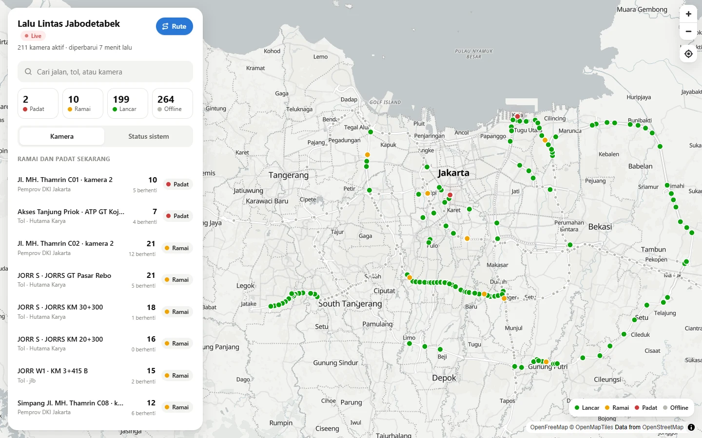

# traffic-cctv-tracker

Peta macet Jabodetabek dari CCTV publik: https://traffic.valentinodeenata.com


Server ngambil gambar dari sekitar 210 kamera tiap 5 menit dan ngitung kendaraannya pakai YOLOX. Hasilnya jadi status per kamera.
Ada juga panel rute. Warna jalannya dari TomTom, dan kamera yang dilewati bisa langsung diputar videonya.

## Soal status macet

Versi pertama cuma ngitung jumlah mobil. Hasilnya ngaco: Senayan malam-malam dengan 6 mobil lewat kebaca Padat.

Sekarang tiap kamera diambil 2 gambar berjarak 2 detik, jadi kelihatan mana yang berhenti. Padat baru keluar kalau yang berhenti
jauh di atas biasanya untuk kamera itu di jam yang sama, dan kejadiannya di 2 dari 3 putaran terakhir. Antrean lampu merah
biasanya cuma kena satu putaran. Mobil parkir ada tiap hari, jadi ikut masuk ke angka "biasanya".

Angka persisnya ada di [`scripts/levels.mjs`](scripts/levels.mjs).



## Model

Awalnya pakai YOLOX-nano. Waktu aku cek 50 gambar siang hari, cuma sekitar separuh kendaraan yang ketangkep.
Kamera tol ngirim gambar 1080p, nano ngecilinnya ke 416 px, mobil yang agak jauh hilang. Setelah pindah ke YOLOX-s (640 px),
gambar yang sama dapet 321 kendaraan. Sebelumnya 198.

Bus TransJakarta yang kelihatan dari belakang sempat kebaca "kereta". Kelas kereta akhirnya aku buang,
soalnya KRL beneran di kamera dekat rel ikut kehitung.

Yang masih sering lolos: bus warna gelap dari samping.

## Rute

Pakai TomTom Routing API. Key-nya cuma ada di server, dan dibatasi 600 rute per hari biar nggak lewat kuota gratis.
Mode motor otomatis nggak lewat tol. Rute yang disimpan cuma ada di localStorage browser.

## Stack

Node 24 tanpa framework (`node:http`, `node:sqlite`, `node:test`), onnxruntime-node, ffmpeg, MapLibre + OpenFreeMap, hls.js.
Jalan di VPS 2 GB. Dependency npm-nya cuma `onnxruntime-node`.

## Data

Server cuma nyimpen angka, nggak ada gambar atau video. Data per 5 menit dihapus setelah 7 hari, ringkasan per jam setelah 180 hari.

Datanya baru mulai dikumpulin 17 November 2026. Kalau udah beberapa minggu, rencananya mau dipakai buat nyari jam berangkat yang paling sepi.

## Jalanin

Butuh Node 24+ dan ffmpeg.

```
npm install
curl -L -o models/yolox_s.onnx https://github.com/Megvii-BaseDetection/YOLOX/releases/download/0.1.1rc0/yolox_s.onnx

node scripts/fetch-cameras.mjs          # daftar kamera
PORT=8790 node scripts/collector.mjs    # jalan tiap 5 menit, UI di http://127.0.0.1:8790
node scripts/detect.mjs foto.jpg        # tes deteksi di satu gambar
npm test
```

`DETECT_MODEL=yolox_nano` kalau mau lebih ringan. Panel rute butuh `TOMTOM_API_KEY` di `.env`.

Deploy tinggal push ke `main`, sisanya diurus GitHub Actions. Kalau collector mati setelah deploy, otomatis rollback.
Setup server sekali di [`deploy/bootstrap-server.sh`](deploy/bootstrap-server.sh).

## Sumber kamera

CCTV publik Pemprov DKI (jakcctv.jakarta.go.id/publik), CCTV tol BPJT (bpjt.pu.go.id/cctv), dan Bina Marga.
Kamera Jasa Marga butuh token, jadi nggak ikut tampil. Video nggak disimpan, diputar langsung dari server pemiliknya.
